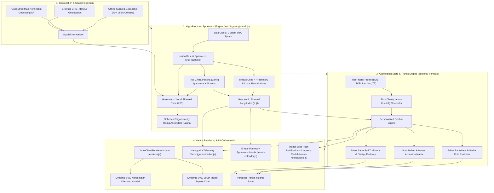

# 🌌 Grahamandal (ग्रह मंडल) — Live Vedic Ephemeris & Gochar Engine

[](https://grahamandal.pages.dev)
[](https://github.com/ashishh-tech/Grahamandal)
[](https://github.com/ashishh-tech/Grahamandal)
[](LICENSE)
[](https://grahamandal.pages.dev)

**Grahamandal (ग्रह मंडल)** is an astronomical-grade, high-precision Vedic Astrology (*Jyotisha*) computational system. Operating entirely client-side, it delivers real-time planetary transits (*Gochar*), sub-arcsecond rising Ascendant (*Lagna*) calculations, dynamic SVG Kundali generation (North and South Indian charts), multi-year ingress matrices, and personalized natal transit overlays using open-standard geospatial coordinates.

---

## 🏛️ System Architecture

Grahamandal is engineered as a decoupled, multi-tier computational pipeline executing in modern browser runtimes with zero external runtime dependencies for core astronomical math.



---

## 🧩 Architectural Subsystems

### 1. Astronomical Calculation Engine (`js/astrology-engine-v8.js`)
The core ephemeris engine is written in pure JavaScript, supplemented with optional WebAssembly Swiss Ephemeris (`swisseph.wasm`).
* **Julian Date Engine**: Converts Gregorian/UTC timestamps into continuous Julian centuries $T$ relative to standard epoch `J2000.0` ($JD\ 2451545.0$).
* **True Chitra Paksha (Lahiri) Ayanamsa**: Precession is computed with secular rate coefficients ($50.278''$ / year) and adjusted for nutation in longitude using the longitude of the Moon's ascending node ($\Omega$) and mean solar longitude:
  $$\Delta\psi = -17.20'' \sin(\Omega) - 1.32'' \sin(2L_\odot)$$
* **Lunar Perturbations (Meeus Chapter 47)**: Implements trigonometric series expansions encompassing solar anomaly ($M$), lunar anomaly ($M'$), elongation ($D$), and argument of latitude ($F$) to achieve sub-arcminute lunar precision.
* **Ascendant (Lagna) Trigonometric Solution**:
  $$\tan(\lambda_{\text{asc}}) = \frac{-\cos(\theta_{\text{LST}})}{\sin(\theta_{\text{LST}})\cos(\epsilon) + \tan(\phi)\sin(\epsilon)}$$
  Where $\theta_{\text{LST}}$ is Local Sidereal Time, $\epsilon$ is true obliquity of the ecliptic, and $\phi$ is terrestrial geographic latitude.

---

### 2. OpenStreetMap & Spatial Telemetry (`js/personal-transit.js`)
* **OpenStreetMap (Nominatim)**: Performs zero-cost, privacy-respecting forward geocoding and reverse geocoding via public endpoints with debounced requests (300 ms).
* **Browser Geolocation API**: Direct hardware GPS telemetry detection via `navigator.geolocation.getCurrentPosition()`.
* **Zero-Latency Offline Cache**: Pre-packaged catalog of 40+ high-significance Vedic observatories and global metropolises (e.g. Varanasi, Ujjain, Ayodhya, Haridwar, New Delhi, London, New York) enabling sub-millisecond local fallbacks when disconnected.

---

### 3. Dynamic Vector Projection Engine (`js/chart-renderer.js`)
* **Vector Projection (`AstroChartRenderer`)**: Pure scalable SVG output utilizing responsive coordinate spaces (`viewBox="0 0 600 600"`).
* **Zero-Collision Typography**: Employs fixed outer perimeter anchors for Rashi numerals and dynamic centroid vertical stacking for house occupants. Line-height scales adaptively ($14\text{px}$ to $17\text{px}$) when clusters of 4+ planets occupy a single house.
* **Dual Projection Modes**:
  * **North Indian Diamond Chart (*Surya Kundali style*)**: House positions are geometrically invariant; signs rotate based on Lagna.
  * **South Indian Square Chart (*Rasi Chakra style*)**: Zodiac signs are geometrically fixed clockwise; Lagna and planetary symbols rotate through sign boundaries.

---

### 4. Transit Intelligence & Sade Sati Logic (`js/personal-transit.js`)
Given the current planetary longitudes $\Lambda_t$ and native natal coordinates ($\Lambda_{\text{asc}}$, $\Lambda_{\text{moon}}$):
* **Whole-Sign House Cusps**:
  $$H_{\text{natal}}(p) = ((\lfloor \lambda_p / 30 \rfloor - \lfloor \lambda_{\text{asc}} / 30 \rfloor + 12) \pmod{12}) + 1$$
  $$H_{\text{moon}}(p) = ((\lfloor \lambda_p / 30 \rfloor - \lfloor \lambda_{\text{moon}} / 30 \rfloor + 12) \pmod{12}) + 1$$
* **Shani Sade Sati Tri-Phasic Matrix**:
  * $H_{\text{moon}}(\text{Saturn}) = 12$: **Phase 1 (Rising Phase / उदित चरण)**
  * $H_{\text{moon}}(\text{Saturn}) = 1$: **Phase 2 (Peak Janma Shani / शिखर चरण)**
  * $H_{\text{moon}}(\text{Saturn}) = 2$: **Phase 3 (Setting Phase / उतरती चरण)**
  * $H_{\text{moon}}(\text{Saturn}) = 4$: **Kantaka Shani (कंटक शनि चतुर्थ ढैय्या)**
  * $H_{\text{moon}}(\text{Saturn}) = 8$: **Ashtama Shani (अष्टम शनि ढैय्या)**
  * Otherwise: **Sade Sati Free**
* **Guru Balam Matrix**: Auspicious disposition identified when transiting Jupiter occupies houses 2, 5, 7, 9, or 11 relative to the natal Moon sign.

---

### 5. Multi-Year Chronological Matrix (`js/transit-calendar.js`)
* Computes exact ingress and egress ephemerides across a rolling 5-year window (2026–2031).
* Tracks Nakshatra pāda ingresses ($3^\circ 20'$ boundaries) and retrograde (*Vakri*) looping cycles.
* Instantaneous client-side filtering by Graha, Year, and motion classification.

---

## 🖥️ User Experience & View Projections

The interactive interface supports 4 concurrent projection modes:

| Mode | Base Anchor | Planetary Coordinates | Astrological Purpose |
| :--- | :--- | :--- | :--- |
| **🌌 Sky Gochar** | Real-time Rising Lagna | Real-time Sky Longitudes | Real-time observation of current sky over local coordinates |
| **👤 Lagna Gochar** | Native Natal Lagna (H1) | Current Transiting Planets | Analysis of how current transits trigger native birth houses |
| **🌙 Chandra Gochar** | Native Natal Moon (H1) | Current Transiting Planets | Classical Gochar Phala analysis from Chandra Rashi |
| **📜 Janma Chart** | Native Natal Lagna (H1) | Native Birth Planets | Fixed natal baseline horoscope (*Janma Kundali*) |

---

## 📂 Codebase Directory Structure

```plaintext
Grahamandal/
├── index.html                   # Primary application entry point & interactive dashboard
├── transit-calendar.html        # 5-Year Planetary Transit Ephemeris Matrix & Search
├── styles.css                   # Vedic luxury design system & responsive styling
├── mobile-nav.css               # Bottom tactile navigation bar stylesheet
├── mobile-nav.js                # Mobile navigation routing & micro-interactions
├── manifest.json                # PWA Progressive Web App configuration manifest
├── sw.js                        # Service Worker (Stale-While-Revalidate caching v2.3.0)
├── wrangler.toml                # Cloudflare Pages deployment configuration
├── logo.svg                     # Primary vector emblem
├── favicon.svg                  # High-density SVG browser icon
├── favicon.png                  # Fallback raster icon
│
└── js/
    ├── astrology-engine-v8.js   # Core ephemeris, Julian Date, Ayanamsa & astronomical math
    ├── chart-renderer.js        # Dynamic SVG vector generator (North & South Indian charts)
    ├── personal-transit.js      # OpenStreetMap geocoding, GPS locator, & Sade Sati logic
    ├── transit-notifications.js # Real-time Web Notifications, Short Significance, & Ingress Modal
    ├── graha-tracker.js         # Telemetry dashboard, real-time clock, & Graha card bindings
    ├── transit-engine.js        # Real-time transit comparison against natal profiles
    ├── transit-calendar.js      # Multi-year transit chronology and filtering engine
    ├── hindi-translate.js       # Live DOM bilingual translation engine (ENG / हिंदी)
    ├── swiss-ephem-bridge.js    # Interface bridge to Swiss Ephemeris WASM module
    ├── swisseph.wasm            # Compiled WebAssembly Swiss Ephemeris binaries
    ├── swisseph.js              # Swiss Ephemeris Emscripten runtime loader
    └── swisseph.data            # Planetary ephemeris binary data tables
```

---

## 🎨 Design System Specifications

| Token | Hex Value | Semantic Usage |
| :--- | :--- | :--- |
| **Primary (Vedic Gold)** | `#C59820` / `#785A00` | Accents, active indicators, Lagna highlights, gold borders |
| **Secondary (Deep Teal)** | `#006A61` / `#0D9488` | Benefic badges, live status indicator, stable alignments |
| **Tertiary (Saffron)** | `#944A00` / `#E67E22` | Time-travel indicator, Gandanta warning badges, solar accents |
| **Ruby (Retrograde)** | `#DC2626` | Debilitated Graha badges, Vakri motion indicators, Sade Sati Peak |
| **Emerald (Exalted)** | `#059669` | Exalted (*Uccha*) dignity indicators, Guru Balam alerts |
| **Cosmic Slate** | `#151528` / `#1B1C1A` | Typography headings, primary telemetry data readouts |
| **Parchment Surface** | `#FBF9F6` | Eye-friendly luxury cream parchment background |

---

## 🚀 Local Development & Setup

Grahamandal requires **no compilation, bundlers, or package installation** to run locally.

### 1. Clone Repository
```bash
git clone https://github.com/ashishh-tech/Grahamandal.git
cd Grahamandal
```

### 2. Launch Local Server
Using Node.js:
```bash
npx serve .
```
Or using Python:
```bash
python -m http.server 8000
```
Or using PHP:
```bash
php -S localhost:8000
```

Open `http://localhost:8000` in any evergreen browser (Chrome, Safari, Firefox, Edge).

---

## 🌐 Deployment Pipeline

Grahamandal is continuously deployed via **Cloudflare Pages**:
* **Continuous Integration**: Direct push triggers on `main` branch.
* **Edge Delivery**: Assets served from Cloudflare's globally distributed Edge CDN.
* **Manual Deployment via Wrangler CLI**:
  ```bash
  npx wrangler pages deploy . --project-name grahamandal
  ```

---

## 📜 Scientific & Classical References

1. **Brihat Parashara Hora Shastra (BPHS)** — Maharishi Parashara (*Foundational classical tenets of Graha dignities, Bhavas, and Gochar*).
2. **Surya Siddhanta** — Ancient Indian Astronomical Treatise (*Sidereal coordinate frameworks and mean solar motion*).
3. **Phaladeepika** — Mantreswara (*Classical Gochar and Sade Sati delineations*).
4. **Astronomical Algorithms (2nd Ed.)** — Jean Meeus (*High-precision planetary and lunar positional algorithms*).
5. **Swiss Ephemeris (Swisseph)** — Astrodienst Zurich (*High-precision planetary integration validated against NASA JPL DE431/DE440 ephemerides*).

---

## 📄 License

This project is licensed under the **MIT License** — see the [LICENSE](LICENSE) file for details.

Developed with devotion to ancient Vedic astronomy and modern computational engineering. Om Namah Shivaya 🕉️
